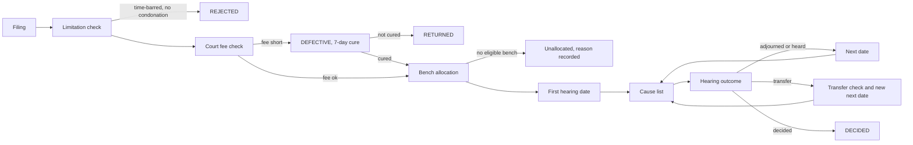
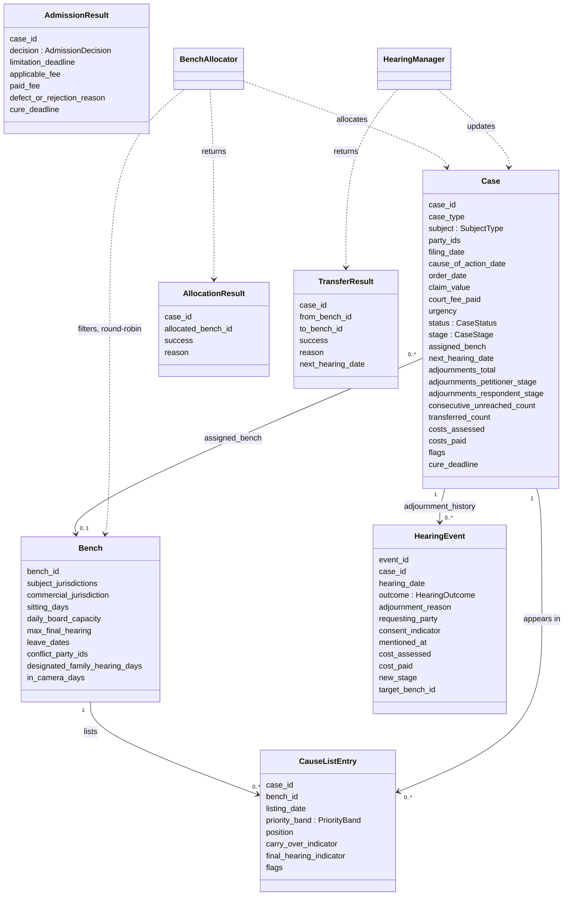
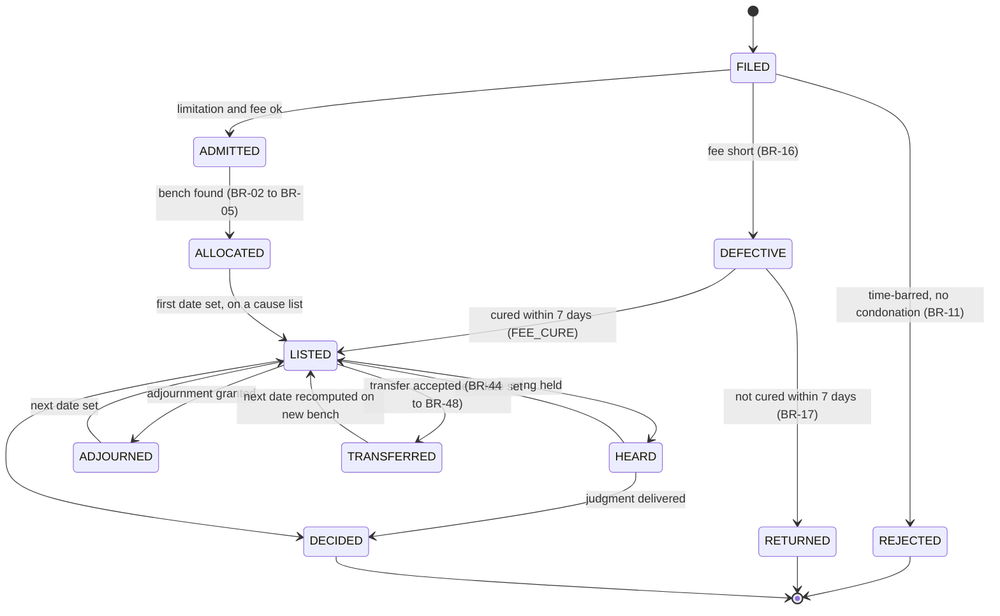
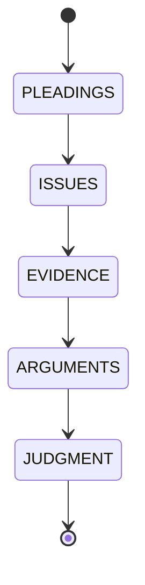

# Final Design Document

**Project:** Court Case Listing and Adjournment Scheduling Engine with Cause-list Priorities and Limitation Periods
**Problem Statement:** PS-118 | **Team ID:** T070 | **Language:** Python 3.10+
**Version:** Week 4 final (updates the Week 1 design in `week1-design.pdf` and the numbered `.docx` files)

This document describes the system as built. Rule-by-rule traceability is in `business-rules.md`, and the reasons behind each ambiguous interpretation are in `decision-log.md`. Diagrams are written in Mermaid and render on GitHub.

---

## 1. Purpose and scope

The engine simulates the work of a district court registry:

1. **Admission:** limitation check (with wrong-forum exclusion, holiday extension and delay condonation), progressive court fee, defect and 7-day cure handling.
2. **Allocation:** match a case to a bench by subject, commercial threshold, party conflicts and round-robin order.
3. **Listing:** build the daily cause list using priority bands, a 40-matter board cap, an 8-matter final-hearing cap, carry-over, escalation and urgent mentions.
4. **Hearings:** record outcomes, enforce stage order and adjournment limits, assess costs, compute the next date, and handle transfers.
5. **Reporting:** cause lists, case diaries, evidence-delay report, Principal District Judge report and pendency report.

It is a command-line program with file input and file output; there is no GUI.

---

## 2. Architecture

### 2.1 Modules

The Week 1 design described a set of services. In the implementation these became modules (and one manager class each where state is needed):

| Week 1 component | Implemented in | Main entry points |
| --- | --- | --- |
| CommandProcessor / InputOutput | `input_output.py`, `main.py`, `official_runner.py` | `load_benches`, `load_filings`, `load_events`, `save_*`; `OfficialRunner.run_commands_file` |
| Domain Models | `models.py` | `Case`, `Bench`, `HearingEvent`, `CauseListEntry`, result classes, enums |
| AdmissionService, LimitationChecker, FeeCalculator | `admission.py` | `calculate_limitation_deadline`, `adjust_for_holidays_and_weekends`, `calculate_court_fee`, `process_admission`, `check_cure_status` |
| AllocationService | `allocation.py` | `BenchAllocator.get_eligible_benches`, `BenchAllocator.allocate` |
| SchedulingService | `scheduling.py` | `determine_priority_band`, `generate_cause_list`, `schedule_urgent_mention`, `get_next_sitting_day` |
| HearingService | `hearings.py` | `HearingManager` (`process_hearing_event`, `process_adjournment`, `advance_stage`, `transfer_case`, `simulate_sittings`), `calculate_next_hearing_date`, `calculate_adjournment_cost` |
| ReportingService | `reporting.py` | `generate_cause_list_report`, `generate_case_diary`, `generate_evidence_delay_report`, `generate_principal_judge_report`, `generate_pendency_report` |
| CalendarService | no separate class | Calendar rules live in `Bench.sitting_days` / `Bench.leave_dates`, a holiday set, and the three date helpers named above |
| Constants | `config.py` | Limitation periods, fee bands, caps, intervals, flag names |

### 2.2 Two entry points

- **`main.py` (JSON pipeline).** Reads `data/*.json`, then runs admission, allocation and cause-list generation for one date, optionally followed by a multi-sitting simulation (`--simulate-until`). It writes 13 JSON and text files.
- **`official_runner.py` (command stream).** Reads the official CSV data pack and `commands.txt`, processes the commands strictly in file order and writes four evaluation CSVs. `main.py --commands ...` delegates to it.

Both entry points share the domain models, `config.py`, the limitation and fee calculators, `BenchAllocator` and `determine_priority_band`. The command runner keeps its own stateful logic for next-date selection, hearing outcomes, transfers and cause-list printing (`find_next_date_for_case`, `process_outcome_command`, `process_transfer_command`, `process_print_cause_list_command`), because the command file mutates shared state across months. The two paths can therefore differ in small details; the known one is DEC-02.

### 2.3 Processing flow

The order limitation, then fee, then roster, then conflicts is fixed by BR-12.

---

## 3. Class diagram

The model keeps case data, bench calendars, hearing events and cause-list entries separate. Behaviour lives in the modules of Section 2.1, not in the model classes.

Enumerations (all in `models.py`):

| Enum | Values |
| --- | --- |
| `SubjectType` | CIVIL, COMMERCIAL, FAMILY, CRIMINAL |
| `CaseStatus` | FILED, UNDER_SCRUTINY, ADMITTED, DEFECTIVE, REJECTED, RETURNED, ALLOCATED, LISTED, HEARD, ADJOURNED, DECIDED, TRANSFERRED |
| `CaseStage` | PLEADINGS, ISSUES, EVIDENCE, ARGUMENTS, JUDGMENT |
| `HearingOutcome` | HEARD, PART_HEARD, ADJOURNED, DECIDED, TRANSFERRED |
| `AdjournmentReason` | PARTY_REQUEST, MEDICAL, COURT_OCCASIONED, ROSTER_CHANGE, CONFLICT, LAWYER_ABSENT, OTHER |
| `PriorityBand` | 0 disposal target, 1 urgent, 2 part-heard, 3 three or more adjournments, 4 older than two years, 5 final hearing, 6 regular |
| `AdmissionDecision` | ADMITTED, DEFECTIVE, REJECTED, RETURNED |

---

## 4. State diagrams

### 4.1 Case status

Notes on how this maps to the code:

- `UNDER_SCRUTINY` exists in the enum from the Week 1 design but is not stored as a separate state; limitation and fee are evaluated in a single step in `process_admission`.
- A filing cured by `FEE_CURE` is registered, allocated and listed in one step by the official command runner, so it goes straight to `LISTED`. The JSON pipeline only detects the uncured case (`check_cure_status` returns `RETURNED` once the deadline has passed).
- A filing whose allocation fails stays `ADMITTED` with no bench and a reason (DEC-11).
- `TRANSFERRED` is limited to one transfer per case, only for `ROSTER_CHANGE` or `CONFLICT` (DEC-12).

### 4.2 Stage progression

A stage can be skipped only when the hearing event carries a consent flag (BR-31). Reaching `ARGUMENTS` gives final-hearing priority, subject to the cap of 8 per bench per day (BR-32). More than 180 days in `EVIDENCE` sets the `DELAY` flag and adds the case to the Principal Judge report (BR-33). Party adjournment counts are kept per stage and reset when the stage changes (BR-34).

---

## 5. Key algorithms

### 5.1 Limitation (BR-07 to BR-12)

1. Start date: cause-of-action date (suits), amount-due date (money recovery) or order date (appeals, revisions).
2. Add the period: 3 years (suits, money recovery), 30 days (appeals), 90 days (revisions).
3. Add `wrong_forum_days`.
4. If the result is a weekend or court holiday, move to the next working day.
5. Filed after that day: `REJECTED` without a condonation application, otherwise admitted with `DELAY_CONDONATION_PENDING`.

A 3-year period starting on 29 Feb ends on 28 Feb when the target year is not a leap year (DEC-14).

### 5.2 Court fee (BR-13 to BR-18)

Marginal slices: 5% up to ₹1 lakh, 4% on the part above ₹1 lakh up to ₹10 lakh, 2% above ₹10 lakh, capped at ₹3 lakh. Appeals pay 50% of the original fee. Claims of exactly ₹1 lakh and ₹10 lakh fall in the lower slice (DEC-03). A short fee makes the filing `DEFECTIVE` with a 7-day cure deadline.

### 5.3 Bench allocation (BR-02 to BR-06)

1. Keep benches whose roster includes the case subject.
2. For a commercial claim above ₹3 lakh, keep only commercial benches (exactly ₹3 lakh is not above).
3. Drop benches whose conflict list contains any party of the case.
4. Pick the next bench in round-robin order for that roster. If none is left, report the case as unallocated with a reason.

### 5.4 Priority band and cause list (BR-19 to BR-28)

Band order, highest first: commercial disposal target (0), urgent (1), part-heard (2), three or more adjournments (3), older than two years (4, DEC-18), final hearing (5), regular (6). A matter unreached on 3 consecutive sittings moves up one band (and shows `BUMPED`). Within a band the oldest filing date goes first, and carry-over matters go first. Caps apply last: 40 matters per bench per day, 8 final-hearing matters. An urgent mention before 10:30 is listed the same day if the board has fewer than 40 matters, otherwise at position 1 on the next sitting day.

### 5.5 Next hearing date (BR-39 to BR-42)

1. Earliest date = adjournment date plus 14 days (7 for urgent and overdue commercial matters).
2. Take the first date from there that is a sitting day, not a holiday, not a bench leave day, and has board capacity.
3. If none is found within 60 days of the adjournment, list on Day 60 (rolled forward to a sitting day) with the `OVERBOARD` flag (DEC-10).

### 5.6 Transfers (BR-44 to BR-48)

A transfer is refused if the case was already transferred, the reason is not `ROSTER_CHANGE` or `CONFLICT`, or the destination bench fails the subject, commercial-threshold or party-conflict check. A successful transfer keeps stage and history, counts as an adjournment, and recomputes the next date on the destination bench's calendar.

---

## 6. Changes since Week 1

| Area | Week 1 design | Final implementation |
| --- | --- | --- |
| Structure | Named services (AdmissionService, FeeCalculator, ...) | Modules with functions, plus `BenchAllocator` and `HearingManager` classes |
| Calendar | `CalendarService` class | Calendar fields on `Bench` plus three date helpers; no separate class |
| Case state | Basic lifecycle | Added `transferred_count`, per-stage party adjournment counters, `costs_assessed`, `costs_paid`, `consecutive_unreached_count` |
| Bench | Subjects, days, capacity, leave, conflicts | Added `in_camera_days`, `max_final_hearing`, `presiding_officer` |
| Priority | Bands 1 to 6 | Added band 0 for the commercial disposal target (BR-25, BR-28) |
| Entry points | One CLI | JSON pipeline (`main.py`) and official command runner (`official_runner.py`) |
| Outputs | Reports | 13 JSON/text reports plus 4 official CSVs |
| Documentation | Design `.docx` set | This document, `business-rules.md`, `decision-log.md` (DEC-01 to DEC-18) |

---

## 7. Testing approach

- **106 tests in 8 modules**, runnable with `python -m pytest` or `python -m unittest discover tests`.
- Unit tests per module cover the rule boundaries (₹1 lakh and ₹10 lakh fee edges, fee cap, 7-day cure, 14-day minimum, 40 and 8 caps, one-transfer limit).
- `test_integration.py` covers end-to-end flows and negative input validation.
- `test_official_scenarios.py` runs the official command stream and checks every planted edge case EC-01 to EC-08 plus the extra traps.
- Every rule BR-01 to BR-51 is mapped to its function and test in `business-rules.md`.

---

## 8. Known limitations

See Section 11 of the README and the decision log (DEC-02, DEC-14, DEC-16 in particular). The two items still worth confirming with the course team are the final `admissions.csv` status for filings cured or returned after a `FILE` command (DEC-16) and the cost for a `MEDICAL` fourth adjournment in the JSON pipeline (DEC-02).
